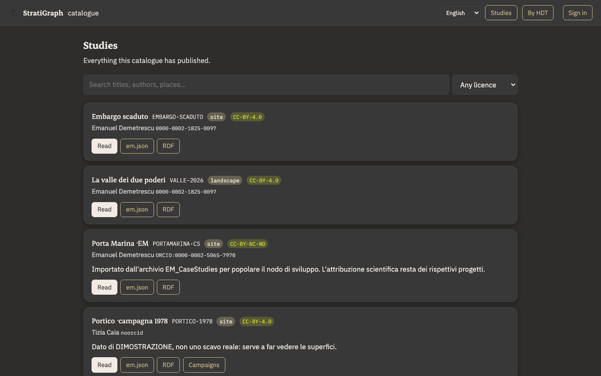

# What is on the node

Nobody says «I use the catalogue». They say «let me see what there is on the
node» — which studies are published, who made them, whether somebody has already
studied the monument they are about to dig. The page that answers is the
node's **catalogue**, at `/catalog/` under the node's address
(`https://em.localhost:8443/catalog/` on the development node). It is linked
from the node's door, and it needs no sign-in.

Every answer on this page was asked of the development node on 19 November
2026; the studies in it are demonstration data, and say so.

## The studies



Each study is a card: its title and code, whether it is a **site** or a
**landscape** (a study made of other studies), its licence, its authors with
their ORCID iD. Three buttons on each:

- **Read** opens the study as a story, in the browser: the narrative its
  authors wrote, with the graph's units, images and 3D in their places, as the
  graph says *now* — a unit renamed yesterday shows its new name;
- **em.json** downloads the study itself, the file EMStudio, EMtools and
  StratiField open — the one that can be edited again;
- **RDF** downloads the same study as linked data, for publication and for
  other systems. It cannot be edited back: what it does not carry is the history
  of each field.

A fourth, **Campaigns**, appears when the same heritage object has more than one
study: see below.

The box at the top searches titles, authors and places; the menu beside it
keeps one licence. The same question, asked by a program:

```bash
curl -s "https://em.localhost:8443/catalog/studies?q=portico"
```

```text
flat 2
PORTICO-1978  Portico · campagna 1978  CC-BY-4.0  public
PORTICO-2026  Portico · campagna 2026  CC-BY-4.0  public
```

(the answer is JSON, one card per study; here only `view`, `count` and four
fields of each card are shown).

## What you see, and what you do not

The catalogue shows a study to somebody who has not signed in only when it is
**public** and its **embargo**, if it has one, has passed. Both are decided in
the room, by its administrators (*Who sees the study*, in
[Working in a room](ROOM-GUIDE.md#who-sees-the-study)); the catalogue never
decides on its own.

On the development node that day the catalogue held 69 studies, and showed 39
of them to a visitor:

```bash
curl -s https://em.localhost:8443/catalog/health      # "studies": 69
curl -s https://em.localhost:8443/catalog/studies     # "count": 39
```

A study that is restricted, or public with an embargo until 2099, is not in the
list; asked for by its id, it answers that a sign-in is needed, and nothing
else — not its title, not whether it exists:

```bash
curl -s https://em.localhost:8443/catalog/study/study:0ac900d3-2610-488d-9ad5-302f4acdc73c
```

```json
{"detail":"missing bearer token — send 'Authorization: Bearer <access token>'"}
```

**Sign in**, at the top right, and the restricted studies appear too — all of
them. Here the catalogue and the room do not ask the same question, and it is
better to know it: the room's door asks whether you have a role in *that*
room, the catalogue asks only whether you signed in. Signed in as `outsider`, a
development account with a role in no room at all, the same two questions
answered:

```bash
curl -s -H "Authorization: Bearer $OUTSIDER" https://em.localhost:8443/catalog/studies   # "count": 69
curl -s -H "Authorization: Bearer $OUTSIDER" -o /dev/null -w "%{http_code}\n" \
  https://em.localhost:8443/catalog/study/study:02b17e7d-38ab-481a-bbc5-c29483fba261     # 200
```

(`$OUTSIDER` is the account's token, `dev-stack/token.sh --user outsider`; the
second study is restricted.) So on today's catalogue *restricted* means «not
for visitors», not «only for the people of the room», and the same goes for a
study under embargo. For a visitor who has not signed in, the two agree,
embargo included.

## One monument, many campaigns

A heritage object studied more than once — a portico dug in 1978 and again in
2026 — has one **digital twin** (HDT) and several studies hanging on it. **By
HDT**, at the top, groups the catalogue that way; **Campaigns** on a card opens
the group it belongs to:

```bash
curl -s "https://em.localhost:8443/catalog/hdt/https%3A%2F%2Fexample.org%2Fhdt%2Fportico-saggio-b"
```

```text
hc2: https://example.org/hdt/portico-saggio-b   count: 2
hc1: Portico di Saggio B (site)
PORTICO-1978  Portico · campagna 1978
PORTICO-2026  Portico · campagna 2026
```

Before opening a new study, it is worth asking whether the place already has a
twin. The catalogue's register answers, and says where it looked:

```bash
curl -s "https://em.localhost:8443/catalog/twins?q=portico"
```

```text
sources: this catalogue — ok, 1 · StratiGraph collaborative cloud — not_configured
twin:    Portico di Saggio B · HDT   2 studies
         custodians: Tizia Caia, Emanuel Demetrescu (0000-0002-1825-0097)
untwinned: 8
```

It suggests and never obliges: a study with no twin is an ordinary study (eight
of them, on that node), and «the cloud is not configured» is said rather than
passed off as «nobody has one».

## Opening a study in a tool

From a study to the tool that opens it, the catalogue answers with what it
knows and marks what is only proposed:

```bash
curl -s "https://em.localhost:8443/catalog/study/study:d2385976-1055-44e5-929b-0cfc1d947328/open?app=emstudio"
```

```json
{"study": "study:d2385976-1055-44e5-929b-0cfc1d947328",
 "emjson": "https://em.localhost:8443/catalog/study/study:d2385976-…/emjson",
 "apps": {"emstudio": {
   "scheme": "stratigraph://open?study=study%3Ad2385976-…&catalog=https%3A%2F%2Fem.localhost%3A8443",
   "registered_in": ["emstudio-desktop"], "web": null, "…": "…"}}}
```

The `stratigraph://` link opens the study in EMStudio's desktop build, where
that link is registered; everywhere else, the `emjson` address is the one that
works — in EMStudio, in EMtools, in StratiField. (Abridged: the ids are cut
with `…`, and the note the answer carries is left out.)

## A published study is not a room

The catalogue shows studies **as published**. Work in progress lives in a room
([Working in a room](ROOM-GUIDE.md)), and a room appears in the catalogue only
when its administrators publish it. Publishing does not close the room.

How the catalogue is built — a study *is* its em.json, the index is rebuilt
from the files, the contract a production catalogue is held to — is in the
[catalogue's own repository](https://github.com/StratiGraph-ECCCH/stratigraph-catalog/blob/main/README.md).
