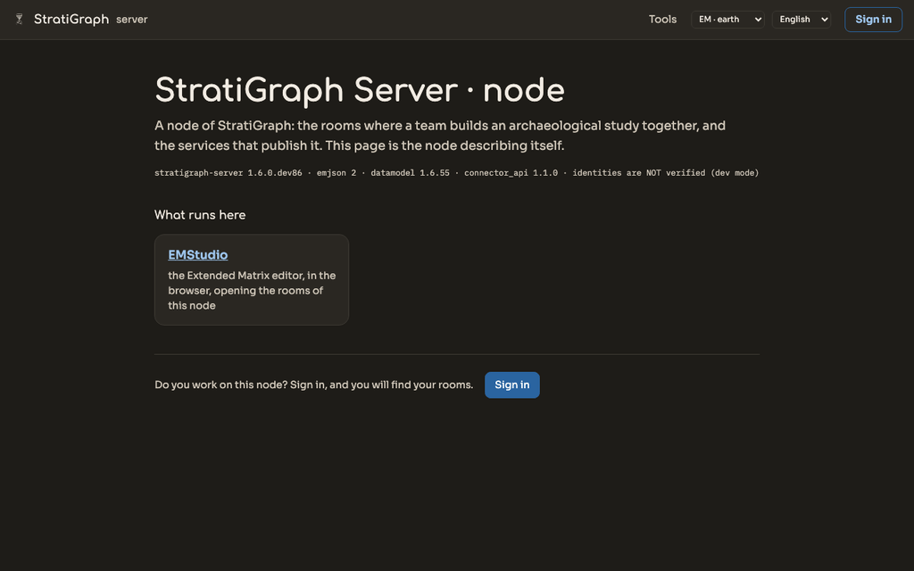
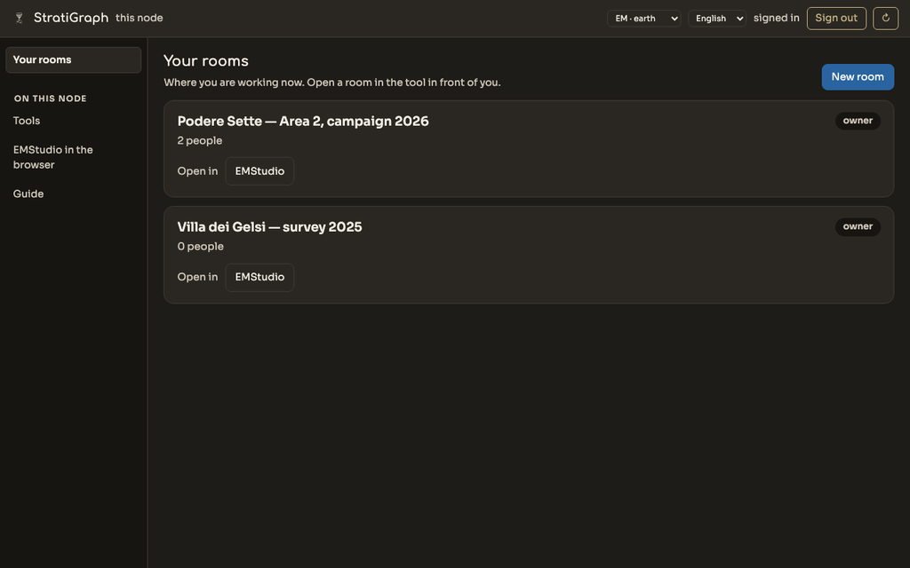
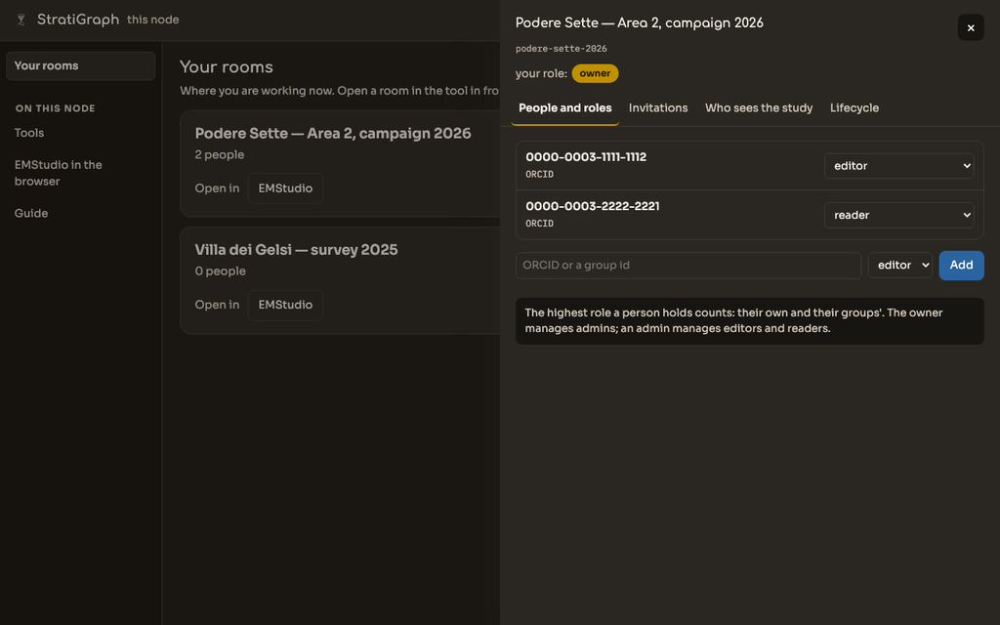

# Working in a room: a guide for editors and administrators

StratiGraph Server · for the archaeologists who work in a study, and for those
who decide who works in it with them. Nothing here needs the node console: all
of it is done from the node's web pages and from the tools.

## A room in three sentences

A **room** is where one study is worked on together: its Extended Matrix graph,
the em.json, kept live on the node. Everyone who has a **role** in the room sees
the same graph and every change as it happens, signed with the ORCID of whoever
made it. The room also keeps the study's files, the conversation of the team and
the history of every operation.

## Your role in a room

| Role | What you can do |
|----|----|
| **Reader** | Open the room, read the graph, see and download its files, read the conversation. |
| **Editor** | Everything a reader does, and write: change the graph, upload files, keep snapshots of a Blender file, write in the conversation. |
| **Administrator** | Everything an editor does, and decide about people: add and remove editors and readers, make invitation links, decide who sees the study, archive the room. |
| **Owner** | One per room. Everything an administrator does, and manage the administrators, hand the room to someone else, delete it. |

Your role is the same in every tool: the web page, EMStudio, EMtools in Blender,
StratiField on the phone. When a tool refuses something, the sentence it shows
says which role was needed.

## Signing in

Open the node's address in a browser — the one your node manager gives you, for
example `https://192.168.1.214:8443` — and you are at the **door** of the node:
one sentence on what is done here and one button.

- **With a network**: *Sign in with ORCID*, with your usual ORCID account.
- **On the excavation, without a network**: *sign in with the node's password*.
  User name = your ORCID iD (for example `0000-0002-1825-0097`), password = the
  field password the node manager gave you. The first time, the node asks you to
  choose your own.

Inside the house, the bar at the top calls this page *This node*: it is the way
back to the door from any page. The door is composed by the node itself, from
what it declares at `/v1/node`, so it shows what runs on *this* node and
nothing else. Under *What runs here* there is one row for each service the node
has, with one sentence on what it does and, when it is not answering, a word
that says so:

- **Catalogue** — the published studies, searchable, each one a link to read
  it (see [What is on the node](CATALOGUE.md));
- **Images (IIIF)** — the images of the studies, at any size;
- **StratiField** — the field assistant, to dictate and record on the
  excavation from a phone;
- **EMStudio** — the editor, in the browser, opening the rooms of this node;
- **Photogrammetric engine** — it turns photographs into 3D models, for the
  rooms of this node.

A service the node does not have is not drawn: a node on a laptop may show only
EMStudio, as in the picture above.

Below the button, without signing in, are the published studies, the tools to
install and this guide. What the published studies look like, and how to look
through them, is in [What is on the node](CATALOGUE.md).

If you have forgotten the field password, ask the node manager for a new one:
nobody can read the old one, not even them.

## Your rooms

After signing in you are in the node's **house**, on **Your rooms**: the rooms
where you hold a role, and no other. Each one has its doors:

- **EMStudio** opens the room in the program installed on your computer. If
  nothing opens within two seconds, the page offers to install EMStudio;
- **In the browser** opens EMStudio in a new tab, with nothing to install;
- **On the phone** shows a QR code: frame it with the phone's camera and
  StratiField opens in that room;
- **EMtools** copies the room's link for Blender: in Blender, EMtools → *Open
  room from link…*, and paste. Beside it, the way to install Blender and EMtools
  the first time.

A link never carries your password or your session: whoever receives it still
signs in with their own identity, and enters only with their own role.

Archived rooms are gathered at the bottom. **New room** is at the top if your
profile on the node allows it (*node editor*); otherwise the page says whom to
ask. Whoever creates a room is its **owner**.

**Tools**, in the column on the left, explains step by step how to install
EMStudio, and Blender (4.4 or later) with EMtools. The node declares two tools,
and for each one where to download it and where its own manual lives — those
manuals are written by the tools' authors, not on this node:

- **EMStudio** — the guide is at <https://docs.extendedmatrix.org>;
- **EMtools (Blender)** — the installation guide is at
  <https://docs.extendedmatrix.org/projects/EM-tools/en/1.5/installation.html>.

A node can point both addresses elsewhere — a field node with no route out
points them at a copy on its own disk — and the page then shows the node's
addresses, not these.

## One room, opened

Click a room's name, or *People and sharing*, and the room opens on the right:

- **People and roles** — who works in it, with which role;
- **Invitations** — the links that bring somebody in;
- **Who sees the study** — restricted or public, and the embargo;
- **Lifecycle** — archive, hand over, delete (for whoever governs the room).

A reader or an editor sees the first three as they are, with a sentence saying
who can change them.

## Putting a file into a room

A room keeps the study's files — photographs, point clouds, drawings, the
models — and an editor is who may add them. Since the end of November 2026 a
file and the few lines that say where it comes from travel **together**: the
tool you are depositing from asks you for them before it sends anything, and a
node will not take a file that arrives without them.

What it asks for is short, and it is all things you know:

* **the licence** — what others may do with the file. Without it the node
  refuses the deposit, and it is right to: a file nobody may use is a file
  nobody will;
* **where it comes from** — the kind of act that produced it. Either you made
  it here (a photograph, a laser scan, a survey, a drawing, a recording sheet)
  or you brought it from somewhere else (a download, an import, a reference).
  If it is a download, the node also wants the address or the DOI it came from;
* **when**, for something made here: the day the photograph was taken, not the
  day you are depositing it;
* **how**, again only for something made here: the technique and the software.
  On a file you downloaded the node refuses these, because they would be a
  claim about an act that somebody else performed;
* **who answers for publishing it**, when that is not you: an ORCID iD the node
  has accredited. A name typed by hand is not enough, and the node says so with
  the iD in the sentence.

A refusal always names the thing that is missing, and nothing is stored until
the record holds: a file you got wrong leaves nothing behind to clean up.

Why the insistence. A file in a bucket with no story is a file that, in two
years, nobody can publish, cite or hand to an archive — and the moment when
somebody still knows where it came from is the moment it is deposited, not the
moment somebody needs it. The same record is what lets the room tell you later,
in one answer, who made a file, under which licence it sits, what it was made
from and what was made out of it.

## Sharing a room — for administrators and owners

The room's panel (*People and sharing*) is where the people of the room are
decided. An editor or a reader sees it with a sentence explaining that this part
belongs to the administrators; *Who sees the study* stays visible to everyone,
read-only.

### Adding a person

In *People and roles*, type the person's **ORCID iD**, choose the role, *Add*.
The person sees the room the next time they open the house. To change a role or
take somebody out, use the menu beside their name.

Give **editor** to whoever writes in the graph, **reader** to whoever needs to
follow the work without changing it — a specialist consulting the data, a
student in the first weeks, a colleague of the superintendence. Give
**administrator** sparingly: an administrator decides about the others.

### Adding a team

A **team** is a named list of people, made by the node manager or by a node
editor, or written in the node's list (see
[People, profiles and roles](ROLES-AND-USERS.md)). Type the team's
id where you would type an ORCID, and the whole team gets the role at once;
whoever joins the team later gets it too. When a person has a role of their own
and one through a team, the higher one counts.

### Inviting with a link

In *Invitations*, choose the role (editor or reader) and how long the link
lasts, then *Create link*. It is copied for you and shown once — the node keeps
only a checksum and cannot show it again. Whoever opens it arrives at the node's
door, signs in with their own ORCID and finds the room in their house, with the
role the link offers.

Send invitation links in a private message, never in a public chat or on a
slide, and **revoke** a link once the people it was for have come in.

### Who sees the study

Two choices, and a date:

- **Restricted** (the default) — only the people with a role in the room, after
  signing in.
- **Public** — anyone can read it, even without signing in. This is what
  publishing means: the study appears in the node's catalogue.
- **Embargo until** a date — until that day the study stays restricted, whatever
  is chosen above; on that day it becomes what you chose. Useful to agree a
  publication date with the excavation director or the superintendence and not
  have to remember it.

Choose, set the date if there is one, *Save*.

### The owner

The owner can **hand the room over** (*Lifecycle*) to another ORCID iD — for
instance when the direction of an excavation changes hands. The previous owner
stays as an administrator. Transferring hands over the job of managing the room;
it does not change who signed what in the graph.

### Archiving

At the end of a season, **archive** the room: it stays readable and citable,
nobody writes in it any more, and it can be brought back at the next season with
*bring it back*. Archiving is the normal way to close; it deletes nothing.

### Deleting

Only the **owner** deletes a room, from *Delete the room*, typing the room's id
to confirm. It cannot be undone: the room goes with its em.json and every
revision, its history, its members and its invitations. The files stay on the
node, and the node manager decides about those no other room uses. Nobody may be
inside the room at that moment.

If the room may ever be needed again, archive it instead.

## Good habits

- One room per study. A room is the live copy of one em.json, and each em.json
  lives in one room.
- Before the end of the day, read *The numbers, and their holes* and *Waiting
  for you*: what is unsigned or without an epoch is easier to fix while the
  context is fresh.
- Roles follow the work, not the hierarchy: the person who records the units is
  an editor, whatever their title.
- Agree the visibility and the embargo with the excavation's director at the
  start, not at the end.
- Revoke invitation links after use; remove people who have left the project.
- On the excavation without a network, the work goes on: the node is on site.
  What was written there comes back to the institutional node at the end of the
  campaign, with its signatures.

## Where to go next

The complete rules — profiles on the node, roles, groups, invitations, deleting
— are in [People, profiles and roles](ROLES-AND-USERS.md). The node itself, and
how the field node is prepared, are in
[the field node](https://github.com/StratiGraph-ECCCH/stratigraph-stratifield/blob/main/docs/FIELD-NODE.md), in
StratiField's manual.

The same room, reached by a program instead of a person — a phone in the
trench, a script, a partner's platform — is told from the other side in
[The REST door of a room](REST-API.md): the same roles, the same refusals, as
requests and answers.
